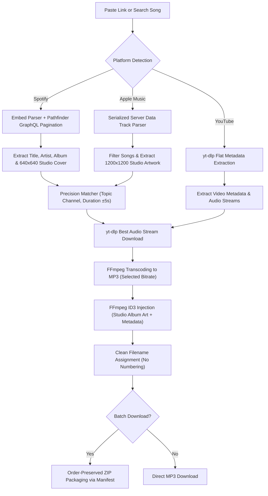

# 🎵 MP3Master

[](https://nextjs.org/)
[](https://www.typescriptlang.org/)
[](https://tailwindcss.com/)
[](https://github.com/yt-dlp/yt-dlp)
[](https://ffmpeg.org/)
[](LICENSE)

A modern, high-performance web application for searching and downloading high-quality MP3 audio from **YouTube**, **Spotify**, and **Apple Music** with lossless **original studio album cover art embedding**, **clean filenames**, and **uncapped batch playlist downloads**.

---

## ✨ Key Features

- **🟢 Zero-API Spotify & Apple Music Importer**: Paste any public **Spotify** or **Apple Music** link (playlists, albums, or individual tracks) to fetch track listings and metadata without requiring developer accounts or API keys.
- **⚡ Uncapped Batch Downloads (No 100-Track Limit)**: Seamlessly imports entire playlists of any size. Utilizes Spotify's internal Pathfinder GraphQL pagination to load playlists beyond the standard 100-track embed cap (tested on 200+ track playlists).
- **🖼️ Original Studio Album Cover Art**: Extracts official high-resolution 1:1 square artwork directly from Spotify (640×640) and Apple Music / iTunes Store (1200×1200+), losslessly embedding it into MP3 ID3 tags via FFmpeg.
- **🏷️ Clean Filename Preservation**: Downloaded tracks retain their exact original written names as shown on Spotify and Apple Music, without artificial track numbering (`01.`, `02.`) or unwanted underscores.
- **📦 Order-Preserving ZIP Export**: Batch downloads can be packaged and downloaded as a single ZIP archive named after the playlist, with file ordering preserved via internal manifest mapping.
- **🎯 High-Precision YouTube Matcher**: Intelligently pairs external tracks with the best audio source on YouTube by prioritizing official YouTube Music topic channels (`Artist - Topic`), verifying exact song duration (±5s tolerance), and filtering out live bootlegs or compilation videos.
- **🚀 Built-in Song Search**: Type any song title or artist name directly into the search bar to preview and download tracks without needing a direct URL.
- **🎚️ Selectable Audio Bitrates**: Choose your preferred audio quality: **320kbps (Extreme Quality)**, **256kbps**, **192kbps**, or **128kbps**.
- **📡 Real-Time SSE Progress**: Live download and audio conversion feedback streamed via Server-Sent Events (SSE) with stage tracking (fetching metadata, audio conversion, metadata embedding).
- **🌓 Minimalist Modern Interface**: Clean, responsive UI built with Next.js 14, Tailwind CSS, and Lucide icons, featuring a one-click Dark / Light mode toggle and built-in binary health checks.

---

## 🔗 Supported URL Formats

| Platform | Supported Types | Examples |
|---|---|---|
| **YouTube** | Videos, Playlists, YouTube Music | `youtube.com/watch?v=...`, `youtu.be/...`, `youtube.com/playlist?list=...`, `music.youtube.com/...` |
| **Spotify** | Tracks, Albums, Playlists (Uncapped) | `open.spotify.com/track/...`, `open.spotify.com/album/...`, `open.spotify.com/playlist/...` |
| **Apple Music** | Songs, Albums, Playlists | `music.apple.com/.../album/...`, `music.apple.com/.../playlist/...` |

---

## 📋 Prerequisites

Before running MP3Master, ensure your machine has the following tools installed:

1. **Node.js**: v18.0.0 or higher ([Download Node.js](https://nodejs.org/))
2. **System Binaries**: `yt-dlp` and `ffmpeg`

### Installing System Dependencies

#### macOS (via Homebrew)
```bash
brew install yt-dlp ffmpeg
```

#### Linux (Ubuntu / Debian)
```bash
sudo apt update
sudo apt install ffmpeg
sudo wget https://github.com/yt-dlp/yt-dlp/releases/latest/download/yt-dlp -O /usr/local/bin/yt-dlp
sudo chmod a+rx /usr/local/bin/yt-dlp
```

#### Windows (via Chocolatey or Scoop)
```powershell
# Using Chocolatey
choco install yt-dlp ffmpeg

# Using Scoop
scoop install yt-dlp ffmpeg
```

> **Note**: Verify installation in your terminal with `yt-dlp --version` and `ffmpeg -version`.

---

## 🛠️ Installation & Setup

### 1. Clone the Repository
```bash
git clone https://github.com/HarshitFreq/MP3Master.git
cd MP3Master
```

### 2. Install Node Dependencies
```bash
npm install
```

### 3. Run the Development Server
```bash
npm run dev
```

Open **[http://localhost:3000](http://localhost:3000)** in your browser.

---

## 🏗️ Production Build

To build and run an optimized production instance:

```bash
npm run build
npm start
```

---

## 📁 Project Architecture

```
MP3Master/
├── src/
│   ├── app/
│   │   ├── api/
│   │   │   ├── batch-download/  # Sequential playlist downloader & manifest ZIP packager
│   │   │   ├── cleanup/         # Automated temporary file garbage collection
│   │   │   ├── download/        # SSE streaming single-track downloader
│   │   │   ├── file/[id]/       # MP3 & ZIP file delivery endpoint
│   │   │   ├── health/          # System binary detector (yt-dlp & ffmpeg)
│   │   │   ├── info/            # YouTube, Spotify & Apple Music metadata parser
│   │   │   └── search/          # YouTube song search API
│   │   ├── globals.css          # Tailwind CSS global styles & custom animations
│   │   ├── layout.tsx           # Root layout with theme provider
│   │   └── page.tsx             # Interactive dashboard with search & download state
│   ├── components/
│   │   ├── BinaryHealthBanner.tsx # Visual warning if yt-dlp/ffmpeg are missing
│   │   ├── DownloadHistory.tsx    # Local history drawer for recently converted tracks
│   │   ├── Header.tsx             # App header with branding and dark mode switch
│   │   ├── ProgressCard.tsx       # Live progress bar with stage and bitrate tags
│   │   ├── UrlDropInput.tsx       # Smart search & link input with clipboard paste
│   │   └── VideoPreviewCard.tsx   # Playlist tracklist selector & download options
│   └── lib/
│       ├── musicImporter.ts     # Spotify (GraphQL paginator) & Apple Music parser
│       ├── types.ts             # TypeScript data contracts
│       ├── utils.ts             # Filename sanitation & duration formatters
│       └── ytdlp.ts             # yt-dlp spawn executor & FFmpeg ID3 metadata tagger
├── public/                      # Static assets
├── package.json
├── tailwind.config.js
├── tsconfig.json
└── README.md
```

---

## ⚙️ How It Works



---

## 🛡️ License

This project is licensed under the [MIT License](LICENSE).

---

## ⚠️ Disclaimer

MP3Master is created for personal, educational, and offline archival purposes only. Please respect the intellectual property rights and terms of service of all media platforms and artists.
